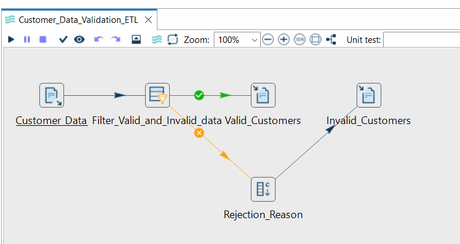
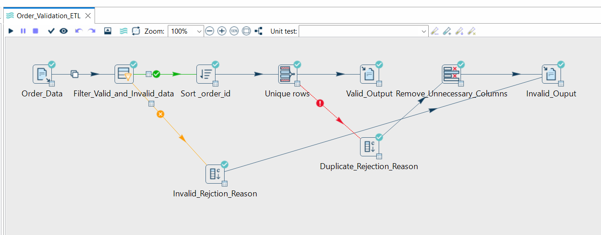
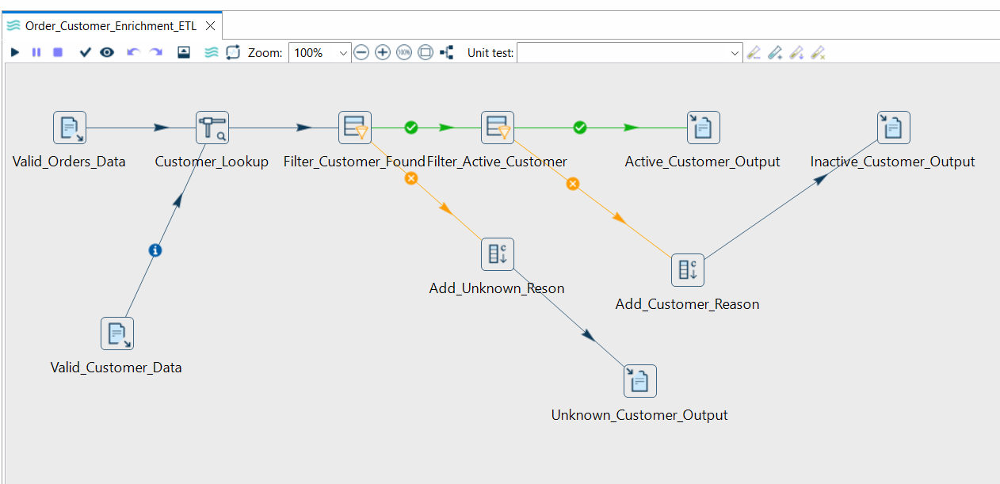
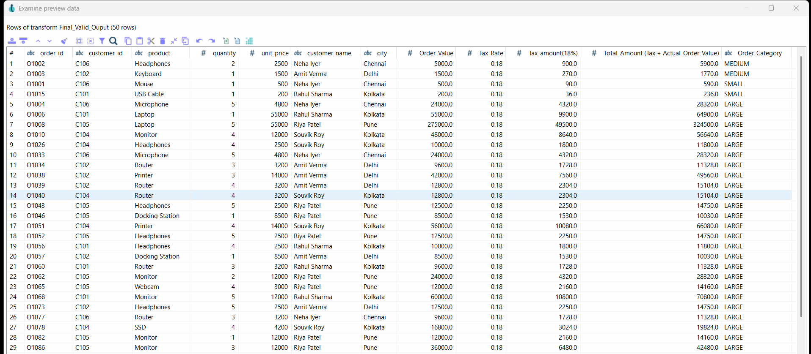
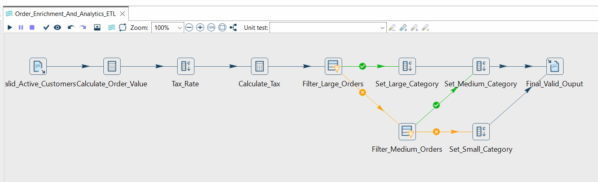
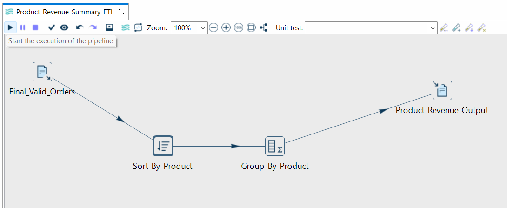
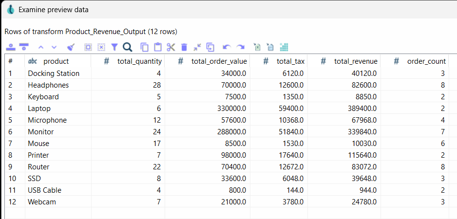

# E-Commerce Order ETL Pipeline

A visual ETL and data quality project built with **Apache Hop 2.19.0** to validate e-commerce orders, clean customer master data, identify duplicate records, enrich transactions, calculate order values and generate product-level revenue summaries.

## Overview

E-commerce systems frequently receive inconsistent data, including missing identifiers, invalid quantities, incorrect prices, duplicate orders and references to unknown or inactive customers.

This project implements a multi-pipeline ETL workflow to process these records using configurable business rules, separate valid and rejected data, enrich eligible orders with customer information and prepare outputs for downstream reporting.

## Tech Stack

- **ETL Tool:** Apache Hop 2.19.0
- **Input/Output:** CSV files
- **Data Processing:** Visual ETL pipelines and business-rule transformations
- **Data Quality:** Validation, deduplication, rejection handling and record checks
- **Analytics:** Order-value calculations and product-level aggregation

## Key Features

- **Order Validation:** Validate required fields, order and customer ID formats, quantities and unit prices.
- **Duplicate Detection:** Identify duplicate orders using `order_id` and separate duplicate records.
- **Customer Data Quality:** Validate customer master records and isolate invalid records.
- **Customer Enrichment:** Join order records with customer details and distinguish active, inactive and unknown customers.
- **Financial Calculations:** Calculate order value, 18% tax and final amount.
- **Order Classification:** Categorize orders by order value using configurable business thresholds.
- **Revenue Reporting:** Aggregate order counts, quantities and revenue metrics by product.
- **Structured Outputs:** Generate separate CSV files for valid, rejected and duplicate records.

## Pipeline Architecture

1. **Order Validation ETL:** Reads order data, applies validation rules, sorts records and separates duplicates.
2. **Customer Data Validation ETL:** Validates customer identifiers, names, cities and customer statuses.
3. **Order Customer Enrichment ETL:** Looks up customer details, filters inactive customers and separates unknown customer references.
4. **Order Enrichment and Analytics ETL:** Calculates order values, tax and final amounts, and classifies orders.
5. **Product Revenue Summary ETL:** Aggregates validated transactions into a product-level reporting dataset.

Each pipeline is designed to address a specific processing responsibility. Pipeline dependencies and execution order should be documented in the repository.

## Business Rules

- Order and customer identifiers must follow the configured formats.
- Required fields must be present.
- Quantity and unit price must be greater than zero.
- Duplicate order IDs are isolated.
- Unknown and inactive customers cannot enter the final eligible-order output.
- Order value is calculated as `quantity × unit_price`.
- Tax is calculated at an illustrative rate of 18% of order value.
- Final amount is calculated as `order_value + tax_amount`.

The tax rate and validation thresholds are configurable project assumptions, not representations of any specific company's tax policy.

## Repository Structure

- `data/` — Synthetic input datasets and data documentation.
- `pipelines/` — Apache Hop pipeline definitions.
- `output/` — Sample generated CSV outputs.
- `screenshots/` — Pipeline canvas and execution evidence.
- `docs/` — Business rules, architecture and implementation notes.

## Getting Started

1. Install Apache Hop 2.19.0.
2. Clone or download this repository.
3. Open the pipeline definitions in Apache Hop.
4. Configure the project paths to point to the local `data/` and `output/` directories.
5. Run the pipelines in their documented dependency order.
6. Inspect the generated output files and compare the results with the expected business rules.

The repository should include only output samples that have been generated and verified by running the pipelines.

## Learning Outcomes

This project demonstrates practical experience with visual ETL development, data quality controls, duplicate handling, lookup-based enrichment, conditional routing, calculated fields and analytical aggregation.

## Author

**Your Name**

[GitHub Profile](https://github.com/Souvik007h)

[LinkedIn Profile](https://www.linkedin.com/in/souvik-developer/)

# Assignment 02 — E-Commerce Order Data Integration

**Tool:** Apache Hop 2.19.0
**Project:** `OrderETL`

## 1. Problem Statement

An e-commerce company receives two CSV files every day: `customers.csv` (customer master data) and `orders.csv` (orders from its online store). The source data may contain missing values, invalid quantities or prices, duplicate orders, unknown customer IDs, and orders associated with inactive customers.

Build a visual ETL pipeline in Apache Hop that extracts both files, validates orders, identifies duplicates, enriches orders with customer information, calculates order values, and separates valid records from rejected records. The original source files must remain unchanged.

## 2. Project Structure

Create the following folder structure:

```text
C:\coding apps\ApacheHopProjects\OrderETL\
├── data\
│   ├── customers.csv
│   └── orders.csv
├── output\
└── pipelines\
    └── order_etl.hpl
```

- Store source CSV files in `data`.
- Write generated output files to `output`.
- Save the Apache Hop pipeline as `pipelines\order_etl.hpl`.

## 3. Input Data

### `customers.csv`

```csv
customer_id,customer_name,city,customer_status
C101,Rahul,Kolkata,ACTIVE
C102,Amit,Delhi,ACTIVE
C103,Anita,Mumbai,INACTIVE
C104,Souvik,Kolkata,ACTIVE
C105,Riya,Pune,ACTIVE
C106,Neha,Chennai,ACTIVE
```

### `orders.csv`

```csv
order_id,customer_id,product,quantity,unit_price
O1001,C101,Laptop,1,55000
O1002,C102,Mouse,2,500
O1003,C103,Keyboard,1,1500
O1004,C101,Monitor,2,12000
O1005,C999,Headphones,1,2500
O1006,C104,Webcam,0,3000
O1007,C105,Keyboard,3,1500
O1008,C102,Mouse,2,500
O1008,C102,Mouse,2,500
O1009,C104,Monitor,1,12000
O1010,C106,Headphones,2,2500
O1011,C105,USB Cable,4,200
O1012,C101,Laptop,1,-55000
O1013,C104,Mouse,5,500
```

## 4. Business Requirements

### Task 1 — Extract

1. Add a separate CSV input transform for each source file.
2. Configure the delimiter, header row, field names, and appropriate data types.
3. Verify parsing in preview.
4. Do not modify either source CSV file.

### Task 2 — Validate Orders

An order is valid only when all of these conditions are true:

- `order_id` is not empty.
- `customer_id` is not empty.
- `quantity > 0`.
- `unit_price > 0`.

Route invalid records to the rejection flow and attach a meaningful `rejection_reason`. Examples:

- `O1006` — `quantity must be greater than zero`
- `O1012` — `unit_price must be greater than zero`

Invalid records must not enter the valid-order flow.

### Task 3 — Remove Duplicate Orders

1. Identify duplicates using `order_id`.
2. Keep one record for each `order_id`.
3. Send duplicate records to `duplicate_orders.csv`.
4. Do not treat different orders as duplicates merely because they share a customer or product.

If the selected Apache Hop unique-rows transform requires sorted input, sort the stream by `order_id` first.

### Task 4 — Enrich Orders with Customer Information

1. Read `customers.csv` as a lookup stream.
2. Match `orders.customer_id` with `customers.customer_id`.
3. Add `customer_name`, `city`, and `customer_status` to each matched order.
4. Reject unknown customer IDs with reason `CUSTOMER_NOT_FOUND`.
5. Reject orders belonging to `INACTIVE` customers with reason `CUSTOMER_INACTIVE`.
6. Allow only `ACTIVE` customers to continue to the final valid output.

### Task 5 — Calculate Order Value

Create a new field:

\[
\text{order\_value} = \text{quantity} \times \text{unit\_price}
\]

For example, quantity `3` and unit price `1500` should produce an `order_value` of `4500`.

Ensure `quantity` and `unit_price` are numeric before calculating.

### Task 6 — Generate Output Files

Write these three files to the `output` directory:

| Output file              | Expected content                                                                                   |
| ------------------------ | -------------------------------------------------------------------------------------------------- |
| `valid_orders.csv`     | Valid, deduplicated orders for active customers, enriched with customer details and`order_value` |
| `rejected_orders.csv`  | Invalid orders, unknown customers, and inactive-customer orders, each with a rejection reason      |
| `duplicate_orders.csv` | Duplicate records identified by`order_id`                                                        |

Keep output flows separate. A rejected record must not accidentally reach `valid_orders.csv`.

## 5. Recommended Implementation Workflow

Test each stage before proceeding:

1. Create the project folders and place both CSV inputs in `data`.
2. Build the input stage with separate CSV input transforms.
3. Validate order fields and route valid and invalid records separately.
4. Add rejection reasons that explain why each invalid record failed.
5. Sort and deduplicate orders by `order_id`, routing duplicates to their own output.
6. Look up customer details using `customer_id`.
7. Separate unknown and inactive customers from active-customer orders.
8. Calculate `order_value` for orders that pass all business rules.
9. Configure three Text File Output transforms and verify their paths.
10. Run the pipeline and inspect every output file.
11. Save the pipeline as `pipelines\order_etl.hpl`.

Suggested transform names: `Read_Orders`, `Read_Customers`, `Validate_Orders`, `Sort_Orders`, `Deduplicate_Orders`, `Lookup_Customers`, `Filter_Active_Customers`, `Calculate_Order_Value`, and descriptive output transform names.

## 6. Expected Pipeline Design

```text
Read_Orders
    |
Validate_Orders
    |------------------------------> Rejected records
    |
Sort_Orders
    |
Deduplicate_Orders
    |------------------------------> Duplicate records
    |
Lookup_Customers <---------------- Read_Customers
    |
Separate unknown / inactive customers
    |------------------------------> Rejected records
    |
Filter active customers
    |
Calculate_Order_Value
    |
valid_orders.csv
```

This diagram is conceptual. Use the normal and error-handling hops appropriate for the transforms you select. Ensure all rejection branches ultimately write to `rejected_orders.csv` with a consistent `rejection_reason` field.

## 9. Completion Criteria

The assignment is complete when the pipeline runs successfully, all three output files contain the expected records, rejected records include reasons, duplicate orders are isolated, and the final valid file contains only eligible active-customer orders with calculated order values.

**Important:** Use Apache Hop's visual GUI for the implementation. Do not replace the ETL pipeline with Python or SQL. Keep source CSV files unchanged and save your work frequently.

## 📸 Pipeline Screenshots

This section showcases the visual ETL workflows and analytical outputs developed using **Apache Hop 2.19.0**.

### 1. Customer Data Validation

Validates customer master data and separates valid customer records from rejected records based on configured business rules.



### 2. Order Validation and Deduplication

Validates incoming order records, checks business constraints, and identifies duplicate orders to maintain data quality.



### 3. Order and Customer Enrichment

Integrates order records with customer master data to validate customer references and classify orders according to customer status.



### 4. Order Customer Output

Demonstrates the output workflow for processing and organizing order records alongside customer information.



### 5. Order Enrichment and Analytics

Enhances validated order data with calculated business metrics, including order values, applicable taxes, and order classifications where implemented.



### 6. Product Revenue Summary

Aggregates order data to produce product-level revenue summaries and other configured business metrics.



### 7. Product Analytics and Insights

Presents analytical outputs derived from processed order data to support product performance and revenue analysis.


