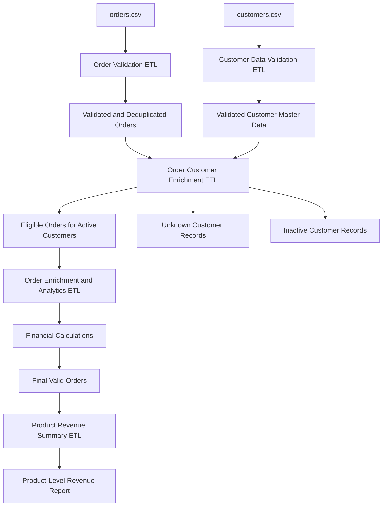

# Pipeline Architecture — E-Commerce Order ETL

## 1. Overview

The E-Commerce Order ETL project is a visual data integration solution developed using **Apache Hop 2.19.0**.

The architecture separates order validation, customer master data validation, customer enrichment, financial calculations, and product-level reporting into distinct pipelines. This modular design makes the workflow easier to understand, test, maintain, and extend.

The solution uses CSV files as its input and output interfaces. Source files remain unchanged, while transformed data is written to separate output files.

## 2. High-Level Architecture



The diagram illustrates the intended logical architecture. The actual execution dependencies and file connections should match the pipeline configurations committed to the repository.

## 3. Pipeline Components

### 3.1 Order Validation ETL

**Purpose:** Validate incoming order records and separate duplicates and invalid data.

**Input:**

- `orders.csv`

**Main processing stages:**

1. Read the source CSV using a CSV input transform.
2. Validate order identifiers and required fields.
3. Check quantity and unit-price rules.
4. Sort records by `order_id`.
5. Identify duplicate order IDs.
6. Route valid, invalid, and duplicate records to separate outputs.

**Outputs:**

- Validated order records
- Invalid order records with rejection information
- Duplicate order records

This pipeline provides the initial data-quality control for order transactions.

### 3.2 Customer Data Validation ETL

**Purpose:** Validate the customer master dataset before it is used for lookups.

**Input:**

- `customers.csv`

**Main processing stages:**

1. Read customer records.
2. Validate customer IDs and required attributes.
3. Validate customer status values.
4. Route valid customer records to the accepted output.
5. Route invalid records to the rejection output with appropriate reasons.

**Outputs:**

- Valid customer master records
- Invalid customer records

Customer master validation helps prevent missing or malformed customer attributes from affecting downstream enrichment.

### 3.3 Order Customer Enrichment ETL

**Purpose:** Enrich valid orders with customer attributes and enforce customer eligibility rules.

**Inputs:**

- Validated order records
- Validated customer master records

**Main processing stages:**

1. Read the order and customer datasets.
2. Match `customer_id` from the order stream against the customer master.
3. Add `customer_name`, `city`, and `customer_status`.
4. Separate orders referencing unknown customers.
5. Reject orders belonging to inactive customers.
6. Allow eligible active-customer orders to continue.

**Outputs:**

- Orders enriched with customer details for active customers
- Orders rejected because the customer was not found
- Orders rejected because the customer was inactive

This stage combines transactional data with customer master data using a lookup-based integration approach.

### 3.4 Order Enrichment and Analytics ETL

**Purpose:** Calculate financial fields and enrich eligible orders for downstream reporting.

**Input:**

- Orders associated with active customers

**Main processing stages:**

1. Calculate order value.
2. Calculate tax using the configured 18% project assumption.
3. Calculate the final amount, including tax.
4. Classify orders by value if the classification stage is implemented.
5. Write the enriched records to the final valid-order output.

**Financial calculations:**

```text
order_value = quantity × unit_price

tax_amount = order_value × 0.18

final_amount = order_value + tax_amount
```

The tax rate is an illustrative project rule and must not be interpreted as a determination of the legally applicable tax rate.

**Output:**

- Final enriched order records

### 3.5 Product Revenue Summary ETL

**Purpose:** Produce an aggregated view of product-level sales performance.

**Input:**

- Final valid-order output

**Main processing stages:**

1. Read final order records.
2. Sort records by product.
3. Group records by product.
4. Aggregate order counts, quantities, and financial measures.
5. Write the summary to a CSV output.

**Output:**

- `product_revenue_summary.csv`

This pipeline is included in the architecture when the reporting workflow has been implemented and tested.

## 4. Data Flow and Dependencies

The intended dependency order is:

1. Validate the order source.
2. Validate the customer master source.
3. Enrich eligible orders with customer information.
4. Calculate financial values and generate final order records.
5. Aggregate the final order records into a product-level summary.

The order and customer validation pipelines operate on separate source datasets. The enrichment stage depends on both datasets being available.

The reporting pipeline depends on the successful generation of the final valid-order output.

Pipeline files should be executed in this dependency order unless orchestration has been configured to manage the dependencies automatically.

## 5. Data Quality and Rejection Handling

The architecture separates several categories of records:

| Category                 | Handling                                                |
| ------------------------ | ------------------------------------------------------- |
| Valid orders             | Continue through enrichment and financial calculations. |
| Invalid orders           | Routed to the order rejection output.                   |
| Duplicate orders         | Routed to the duplicate output.                         |
| Unknown customers        | Rejected during customer enrichment.                    |
| Inactive customers       | Rejected by customer-status validation.                 |
| Invalid customer records | Routed to the customer rejection output.                |

Rejection reasons should identify the applicable business rule, allowing failed records to be investigated without changing the original input files.

## 6. Output Layer

The pipeline outputs are stored in the project's `output/` directory.

| Output                          | Description                                                                                     |
| ------------------------------- | ----------------------------------------------------------------------------------------------- |
| `valid_orders.csv`            | Valid, deduplicated and enriched orders for eligible customers.                                 |
| `rejected_orders.csv`         | Invalid orders and customer-related rejections, where rejection streams have been consolidated. |
| `duplicate_orders.csv`        | Duplicate order records identified by order ID.                                                 |
| `clean_customers.csv`         | Validated customer master records, if generated by the customer validation pipeline.            |
| `rejected_customers.csv`      | Invalid customer records, if generated by the customer validation pipeline.                     |
| `product_revenue_summary.csv` | Aggregated product-level metrics, if the reporting pipeline is implemented.                     |

Actual filenames may differ according to the configured output transforms.

## 7. Design Principles

### Modularity

Each pipeline handles a defined processing responsibility, reducing coupling between validation, enrichment, and reporting.

### Data Integrity

Source files remain unchanged. Data is transformed into separate outputs so that the original records remain available for comparison and investigation.

### Separation of Concerns

Order validation, customer validation, customer enrichment, and financial calculations are handled independently.

### Traceability

Rejected records should include meaningful rejection reasons. Output counts and execution results can be used to verify that processing completed as expected.

### Extensibility

The architecture can be extended with database loading, automated scheduling, execution logging, reconciliation reports, and downstream analytics.

## 8. Execution and Verification

Before treating a run as successful:

1. Verify that the input CSV files exist and have the expected headers.
2. Execute the pipelines in dependency order.
3. Inspect the Apache Hop execution logs for errors.
4. Verify that valid, rejected, and duplicate outputs contain the expected records.
5. Check customer enrichment and financial calculations.
6. Verify that the product summary matches the final valid-order dataset when the reporting pipeline is enabled.
7. Confirm that source files have not been modified.

A successful pipeline execution should be supported by actual output verification rather than the absence of visible errors alone.

## 9. Current Scope and Future Improvements

The current solution focuses on file-based ETL, data quality, deduplication, lookup-based enrichment, calculated fields, and CSV reporting.

Potential future improvements include:

- Record-count reconciliation across pipeline stages
- Centralized rejection outputs and standardized error codes
- Pipeline execution logging and operational monitoring
- PostgreSQL integration for persistent storage
- Automated pipeline orchestration
- Unit-style test datasets and repeatable validation scenarios

These improvements can be introduced incrementally without changing the core modular design.

## 10. Technology

- Apache Hop 2.19.0
- CSV-based source and target files
- Visual ETL transforms and conditional routing
- Lookup-based customer enrichment
- Data validation, calculated fields, and aggregation

The project demonstrates practical ETL design principles through a reproducible, modular data integration workflow.
